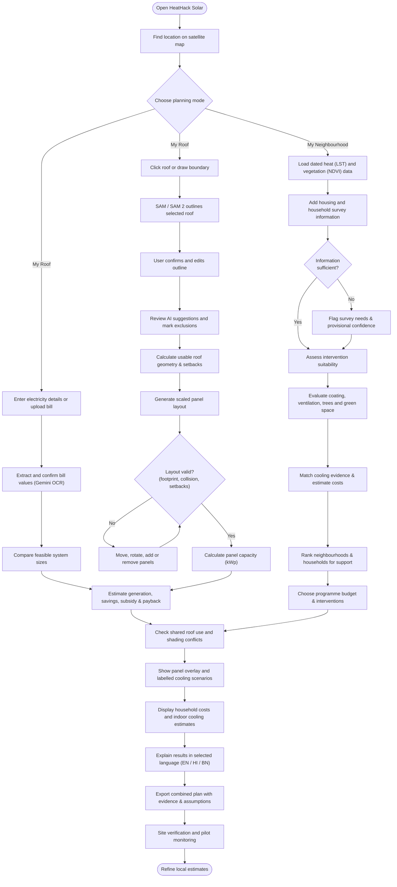

# HeatHack Solar — System Workflow & Journey Map

This document formalizes the operational flow and architecture diagram for **HeatHack Solar**, tracking the path from map discovery to individual rooftop solar sizing and neighbourhood-scale cooling interventions.

---

## 🗺️ Architectural Workflow Diagram

The workflow spans two interconnected operational modes sharing a unified spatial viewport:

---

## 🛠️ Step-by-Step Stage Breakdown

### Stage 1: Location Discovery & Mode Selection
1. **Interactive Geospatial Viewport:**
   - User navigates using search (Nominatim geocoding), geolocation prompt, or coordinates.
   - High-resolution satellite tiles load with scale bars and coordinate reference overlays.
2. **Dual-Mode Toggle:**
   - **My Roof:** Centered on individual dwelling unit geometry, solar placement, and personal utility savings.
   - **My Neighbourhood:** Centered on urban ward/block clusters, thermal vulnerability indexing, and municipal budget allocation.

### Stage 2: My Roof Deep Dive
1. **Rooftop Boundary Delineation:**
   - Zero-shot segmentation via Segment Anything (SAM / SAM 2) triggered by a single positive point click or a drawn bounding rectangle.
   - Interactive polygon vertices enable manual nudging, point addition, or freehand override.
2. **AI Obstruction & Usable Area Identification:**
   - Aerial view crop sent to Gemini Vision to detect water tanks, stairwell towers, satellite dishes, skylights, and existing HVAC.
   - User reviews bounding masks for exclusions.
   - Configurable perimeter setbacks (e.g., $0.5\text{ m}$ safety margin, $1.0\text{ m}$ maintenance walkway) are subtracted via Shapely polygon buffering.
3. **Virtual Panel Placement & Collision Geometry:**
   - Mathematical packing algorithm fills usable polygon with standard module rectangles (e.g., $500\text{ W}$, $2.0\text{ m} \times 1.0\text{ m}$).
   - Users can alter tilt orientation (azimuth), inter-row spacing, and individually nudge/drag or remove individual panels.
   - Real-time validity checks verify that panel bounding boxes do not intersect exclusions or exterior boundary lines.
4. **Tariff & Subsidy Engine (PM Surya Ghar):**
   - User enters average monthly consumption and tariff slab, or uploads a recent bill.
   - Generation modeled with conservative initial assumption of $120\text{ kWh/kW/month}$ (sensitivity $100\text{--}140$).
   - Standard Central Financial Assistance (CFA) calculated:
     $$\text{Subsidy} = ₹30,000 \times \min(C, 2) + ₹18,000 \times \min(\max(C - 2, 0), 1)$$
   - Compares recommended size against sanctioned electrical load and roof limits.

### Stage 3: My Neighbourhood Deep Dive
1. **Thermal & Vegetation Ingestion:**
   - Date-stamped Landsat/Sentinel/MODIS Land Surface Temperature (LST) raster layer.
   - Normalized Difference Vegetation Index (NDVI) overlay.
   - Critical rule: Display clear caveat that satellite surface temperature reflects infrared ground emissions, not indoor or 2-metre air temperature.
2. **Socio-Physical Vulnerability & Survey Gap Tagging:**
   - Combines roof materials (tin, asbestos, RCC concrete, tiles), socio-economic survey data, and heat stress.
   - Missing survey parameters trigger explicit `"Survey required"` badges and lower the confidence rating rather than generating inflated scores.
3. **Evidence-Matched Cooling Interventions:**
   - **Cool-Roof Paint:** Tailored for exposed high-emissivity tin and sheet roofs. Matches empirical Ahmedabad Mahila Housing Trust benchmarks ($\sim 1^\circ\text{C}$ daytime indoor drop).
   - **Ventilation Audits:** Evaluates airflow paths; does not blindly claim temperature reductions without structural design verification.
   - **Urban Forestry & Green Canopies:** Differentiates newly planted saplings from mature cooling potential; flags future shading hazards for nearby solar rooftops.
4. **Multi-Criteria Prioritization & Budgeting:**
   - Transparent scoring weighted by heat hazard, vulnerability index, and intervention cost-efficiency.
   - Outputs aggregated per-household cost:
     $$\text{Cost}_{\text{HH}} = \text{Area} \times \text{Rate}_{\text{coating}} + \text{Prep} + \text{Overhead}$$
   - Prepares ward-level budget scenarios (e.g., 100-home pilot costing ₹5 Lakh).

### Stage 4: Synthesis, Explanation & Pilot Verification
1. **Unified Visualization & Shading Checks:**
   - Overlays planned solar arrays with adjacent proposed tree plantings to highlight potential shading conflicts.
2. **Multilingual AI Advisor:**
   - Explains *why* a 2 kW system might be financially optimal over 3 kW, or *why* a particular informal settlement ranks first for cool-roof assistance, delivered in Bengali, Hindi, or English.
3. **Comprehensive PDF / GeoJSON Export:**
   - Produces engineering concept layouts marked *"Concept layout — installer verification required"* alongside municipal pilot action plans.
